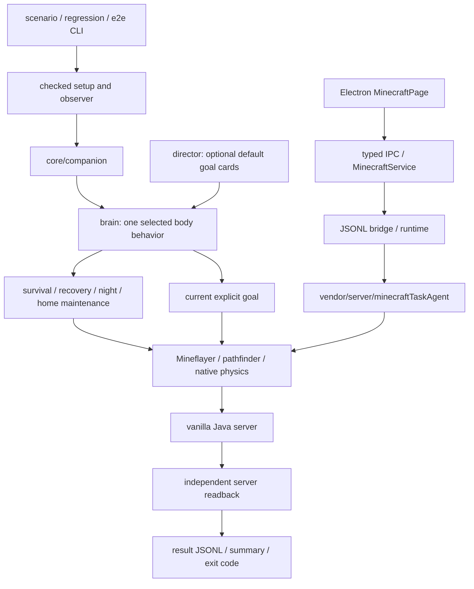

# 代码导航与执行边界

仓库保留两条执行链。新 core 目前由开发者 API 和场景 harness 驱动；Electron 仍走旧代理。两条链的测试、状态和成功条件分别记录。

图中没有 Electron 到新 core 的连接；该适配层尚未实现和验收。`prepare:minecraft` 复制 core 源码进入 helper 不等于命令实际分派给 core。

## 新 core

以下路径相对于 `electron/minecraft-runtime/`。

| 文件/目录 | 职责 |
|---|---|
| `core/companion.js` | 接受现成 bot，配置移动，将感知、行为、brain、director 与显式目标 API 组装起来；负责监听与关停 |
| `core/brain.js` | 选择当前唯一身体行为，用 AbortSignal 中止并等待旧行为交回控制；记录目标完成、失败和恢复 |
| `core/perception.js`、`core/inventory.js` | 从当前世界/库存建立状态，处理固定版本的库存与光标确认边界 |
| `core/actions.js`、`core/skills.js`、`core/confirm.js` | 原生移动、挖掘、放置、交互、制作、熔炼及实际结果确认；保留超时与取消 |
| `core/openDoorPassage.js` | 窄化已开门的 planner 视图；初始 getter 与 native partial path_update 同一 waypoint 修正；单层安装及 owned dispose，不改实际 block/shapes |
| `core/behaviors/` | 逃离、防御、进食、补给、回血、死亡/背包/卡住恢复、夜间休息和已完成家园维护 |
| `core/director.js`、`core/goals/registry.js` | 可选自主调度；默认只有家园、储粮、漏斗刷石机、自动熔炉四类卡片，玩家任务优先 |
| `core/planner.js`、`core/knowledge.js` | 根据当前可用材料与站点计算依赖和下一步需求 |
| `core/mining.js` | 阶梯下矿、主巷/分支、已知路与新探索、危险边界、伴生矿、返程及有界重规划 |
| `core/goals/deviceProject.js`、`gatherMaterials.js` | 将独立装置与家箱/工作站、材料采集和建造阶段连接 |
| `core/goals/`、`core/blueprints/` | 显式任务与布局；蓝图存在或内存完成标记不自动成为验收结果 |

显式 API 包括 `gatherLogs`、`homestead`、`farm`、`ranch`、`netherQuartz`、`gatherMaterials`、`cobbleGenerator`、`autoSmelter`、`caneFarm`、`mobFarm`、`ironFarm`、`carpetDuper`、`railDuper`、`fishing`。`setAutonomy` 管理默认调度，`stop` 同时停止自主选择与当前行为，`dispose` 释放本轮监听和资源。调用者仍负责 bot 的连接与最终断开。

goNear 的 native timeout/fallback 共享一个原始绝对期限；父取消不被 own timeout 吞掉。门适配只在加载、两半一致及扫掠通道清空时接纳已开门，闭门仍拒绝；对 bot 复用安装的 wrapper/listener 只清理自己的实例。刷怪塔的占格蝙蝠处理限于未完成的收集器、原生视线和一次有界攻击，不赋予虚假进度。

目标依据当前世界重新判断下一步，memory 保存站点、路线和观测提示，不作为权威完成凭证。生存行为可以抢占目标；恢复后目标仍须从现状判断。有效进度也不能仅由 steps 上涨或一个成功返回值推断。

## 场景与独立验收

- `scenarios/index.cjs` 是 24 个场景的注册表；`regression.cjs` 是 full 的 32 轮清单。
- `tools/run-scenarios.cjs` 为每个 batch/scenario 启动独立服务器/世界，并执行该场景的轮次。默认同场景复用 bot/world，轮间重新 setup；`--bot-lifecycle fresh` 只改变 bot 生命周期，不会为每轮另建世界。
- `tools/scenario-setup.cjs` 预加载 fixture 区块、检查命令反馈并读回最终矿分布。`vanillaServer.cjs` 对相同回复查询串行化，使用绝对日志偏移，并以控制台 barrier 捕获设置命令自身的结果。
- `scenarios/acceptance.cjs` 提供独立世界时间、生命/位置和交互统计。`furnitureEvidence.cjs` 把原生家具操作与实际目标坐标、服务端方块/统计增量绑定。
- `productionEvidence.cjs` 观察正确机器输出的空基线、容器减少和玩家增加；自动熔炉另核对该炉本轮 RecipesUsed。观察器不发放机器产物。
- `fishingEvidence.cjs` 在 fixture 世界中安装只观察的 data pack，以实际钓获 criterion、物品拾取统计与每次原生 reel 共同确认 catch；垃圾和宝藏不被排除。
- `tools/scenario-result.cjs` 将服务端合同、超时、最终 brain 状态和 harness 错误合并为强失败关闭结果。`run-scenarios` 取消并等待 hook、完成清理后才写最后 result；任意一轮失败使 CLI 非零退出。
- `tools/run-regression.cjs` 聚合 full/quick 的子进程与 summary；`run-e2e.cjs` 管理独立种子的 E2E session。二者不能用组件通过抵消某轮失败。

在 E2E 中，早期家园完成后仍须保持最终房屋、铁装与家具合同；两台机器必须实际完成并产出，四类故障必须恢复，最后仍存活。测试冻结 `a22a73a4a7294ab5409b6e74ee882b2603ab528b`，867 文件 sourceHash `2b47b336ab2279cc27e12ebebf418e508e557e5b09ce4b35a91f97690bf3e73f`。原样完整 runtime full7 自然通过 3326/3326；正式 full03 于 2026-10-24 02:15:09.845—03:27:27.151 UTC 自然完成，24 场景、32/32 轮全部通过，原始结果、退出码与源码/driver 一致。 最终E2E home95/95、gear各1、generator收集8、smelter熔炼5/收集4；已知补煤退化后自主恢复和历史失败见 [VALIDATION.md](VALIDATION.md)。新core仍未接入桌面宿主。

直接场景 CLI 的中断会先 quiesce/join，再关闭结果流并 console stop，summary 保留独立 batch cleanup 收据；批次清理错误使进程非零退出，已经关闭的 round JSONL 保留原样。父 driver 必须另行转发信号。两个真实 door/CLI 控制 probe 与完整玩法验收分别记账。

## Electron 与保留的旧引擎

- `electron/src/renderer/console/MinecraftPage.tsx`：现有连接、任务、库存与状态界面。
- `electron/src/preload/`、`src/shared/minecraft*`：类型化、受限 IPC 输入边界。
- `electron/src/main/minecraft/minecraft-service.ts`：helper 子进程、事件、Provider 与宿主生命周期。
- `electron/minecraft-runtime/index.js`、`bridge.js`、`protocol.js`：旧 JSONL 协议入口，要求独立绝对 data-dir，不自动入服。
- `electron/minecraft-runtime/runtime.js`：旧代理、世界连接、观察和调度循环组装；默认导入 vendor 的 `createMinecraftTaskAgent`。
- `vendor/server/minecraftTaskAgent.js`、`vendor/server/minecraft/`、`vendor/server/action/`：旧任务规划、动作/owner/lease、寻路、家具、生存、战斗、清障及学习合同。

把新 core 接入宿主还需连接身份与事件转换、玩家任务/API 映射、取消/暂停/恢复/重连、持久化边界和实际 UI 到独立服务端终态验收。现有 UI 或 macOS shell 冒烟不证明这条新链已存在。

## 证据与发布

`test/core-*.test.js` 验证新 core 的离线合同；其余 runtime 和 `test-support` 覆盖旧引擎及组件；`electron/tests` 覆盖宿主。`acceptance/` 和 `tools/local-validation/` 有更早的真实/受控/保存世界工具，各自条件不相同。

源码发布包含这些实现、锁文件与有限夹具，但排除本机安装配置、依赖、JDK/JAR、存档、完整日志和个人状态。公开摘要标注冻结 SHA、场景条件、运行计数、失败及尚未验证范围，保留原始证据与推断的区别。
