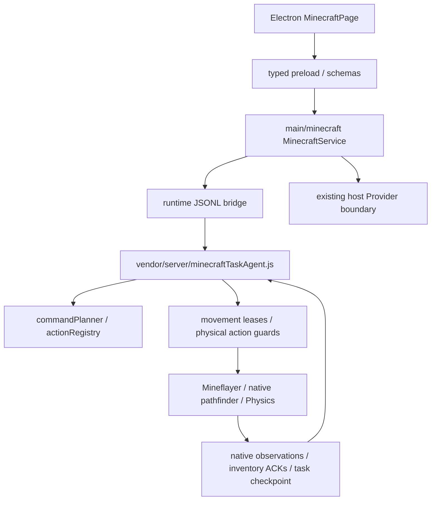

# 代码导航

## 运行时

- `electron/minecraft-runtime/index.js`、`bridge.js`、`protocol.js`：进程入口、JSONL 协议、请求边界。
- `electron/minecraft-runtime/runtime.js`：Mineflayer 连接、运行时与正式代理组装。
- `electron/minecraft-runtime/vendor/server/minecraftTaskAgent.js`：当前大型核心；包含任务、资源、生存、控制权与动作编排，是后续拆分的重点。
- `vendor/server/minecraft/commandPlanner.js` 与 `vendor/server/action/`：受限任务计划、动作注册与参数处理。
- `vendor/server/minecraft/runtimeTickLoop.js`：正式宿主周期调度。
- `vendor/server/minecraft/houseSurfaceGraph.js`：实际已观察地形、原生路径探测、边与到达确认。
- `houseCreeperEscape.js`、`houseRangedCover.js`、`houseCombatMode.js`：战斗、掩护和战后清障。
- `houseSelfSupplyRuntime.js`、`houseResourceGatherer.js`、`survivalScheduler.js`：材料、工具和补给依赖。
- `furnishedHouseBuilder.js`、`furnishedHouseBlueprints.js`、`houseFurnitureUse.js`：正式建筑、蓝图与原生家具使用验收。
- `houseEmergencyRoofAccess.js`、`houseStarterAlcove.js`：临时避难点施工与进入/退出。

以上简写路径均相对于 `electron/minecraft-runtime/vendor/server/minecraft/`，除特别注明者。

## Electron 集成

- `electron/src/main/minecraft/minecraft-service.ts`：子进程、事件、Provider 和生命周期。
- `electron/src/shared/minecraft.ts`、`schemas.ts`、`minecraft-i18n.ts`：类型与输入边界。
- `electron/src/preload/index.ts`：受限 `DeskPetApi.minecraft`。
- `electron/src/renderer/console/MinecraftPage.tsx`：连接、指令、暂停/恢复、任务与库存显示。
- `electron/src/main/app-controller.ts`：服务注册和应用退出。

## 验证层次

- `electron/minecraft-runtime/test/`：单元/组件与原生库合同测试，部分服务器 ACK 明确建模。
- `electron/minecraft-runtime/test-support/fixtures/`：已保存有限地形的离线复现材料。
- `electron/tests/`：宿主 IPC 安全与桌面集成检查。
- `acceptance/`：真实 Vanilla Java 服务器入口、原生事件观察、种子分配与原任务验收。

后续验收应保留同一正式代理、原生动作与实际回包；规划、组件测试或不同运行中的局部成功不自动产生整体验收结果。本文只描述当前结构，不预设后续重构方案。
